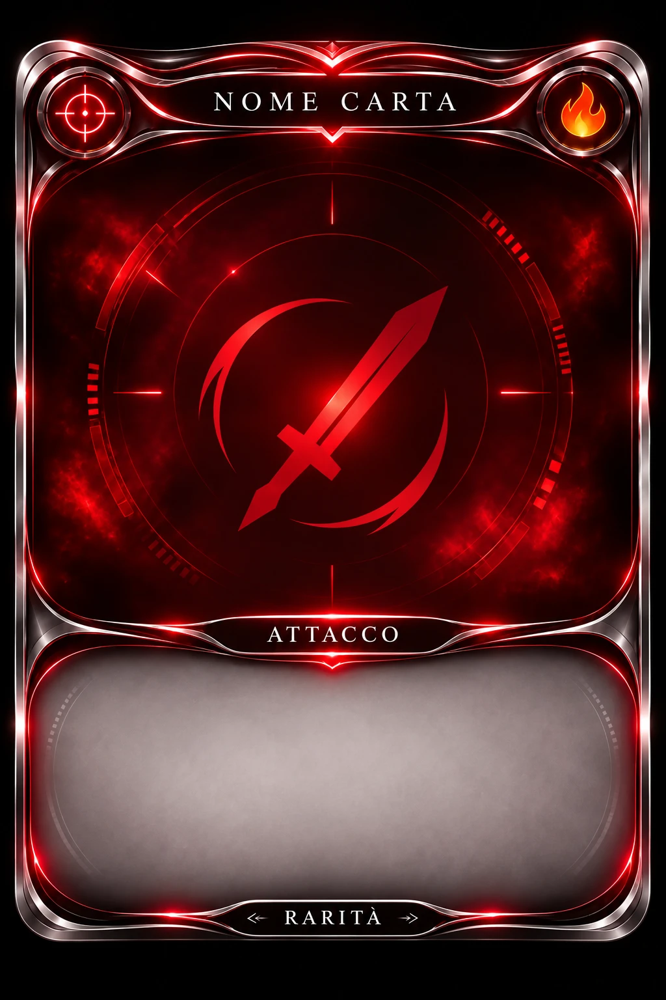
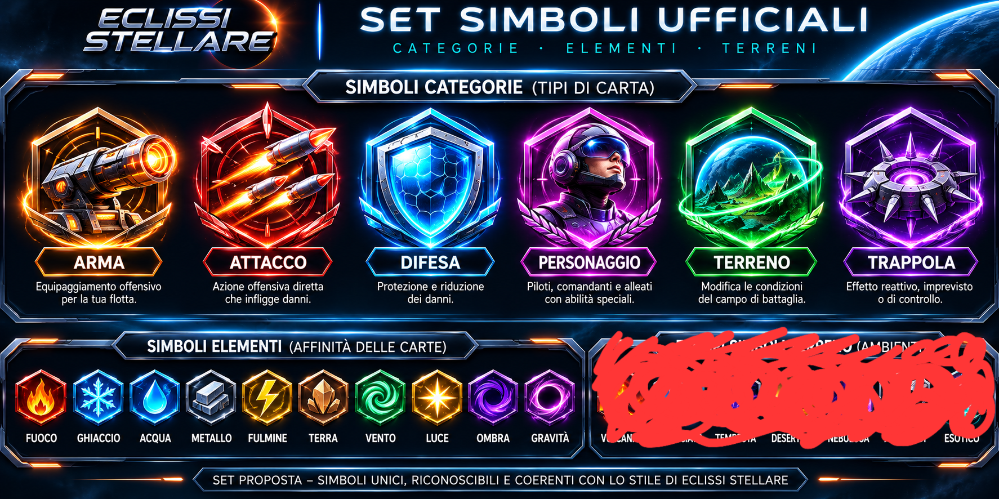

# Eclissi Stellare — riferimenti grafici obbligatori delle carte (21 novembre 2026)

**Stato:** riferimenti forniti e confermati dall'utente il 21/11/2026. **Ambito:** progettazione grafica delle nuove carte; nessuna modifica al motore, ai valori o alla grafica 3D del gioco.

## Immagine 1 — BASE OBBLIGATORIA PER CREARE LE CARTE

**File originale:** `docs/riferimenti-carte/BASE_UFFICIALE_CARTE_2026-11-21.png` (PNG 1024 × 1536, immutato).

Questa è **la base grafica da riprendere**, non un semplice esempio intercambiabile. Tutte le categorie e rarità devono derivare dalla **stessa struttura e dagli stessi allineamenti**, senza reimmaginare la carta:

- Verticale 2:3, cornice metallica argento dalle linee **sottili ed eleganti**, curve continue, non molti riquadri sovrapposti.
- **In alto a sinistra:** alloggiamento per il piccolo **simbolo della categoria**.
- **In alto al centro:** nome della carta, leggibile ma fine, centrato fra i due simboli.
- **In alto a destra:** alloggiamento per il **simbolo dell'elemento**, soltanto per carte che hanno un elemento. **Difesa e Trappola sono universali, quindi non devono mostrare un elemento.**
- **Area grande centrale:** spazio per la futura illustrazione specifica della carta. Il simbolo di spada mostrato nell'immagine è un segnaposto dell'esempio Attacco, **non** un'immagine da applicare a tutte le carte.
- **Tra immagine ed effetto:** denominazione della categoria (ARMA, ATTACCO, DIFESA, PERSONAGGIO, TERRENO, TRAPPOLA), al centro, nella targhetta sottile esistente.
- **Parte bassa:** area per il testo reale dell'effetto, da inserire solo quando la carta sarà prodotta e verificata.
- **Bordo inferiore centrale:** targhetta con rarità (COMUNE, RARA, EPICA, LEGGENDARIA), mantenendo lo stile della base; **non aggiungere bagliori gialli o blu dietro la scritta della rarità**.
- **Nessuna scritta o logo «Eclissi Stellare» sul fronte.**

La base mostra una Carta Attacco rossa e un elemento Fuoco **a titolo di posizione/esempio**; questi dati cambiano nelle varianti. **Non sostituire** questa base con nuovi modelli non approvati.

## Immagine 2 — SIMBOLI DI CATEGORIA E DI ELEMENTO

**File originale:** `docs/riferimenti-carte/SIMBOLI_CATEGORIE_ELEMENTI_2026-11-21.png` (PNG 1774 × 886, immutato).

Utilizzare **soltanto** i due gruppi seguenti, ciascuno nel proprio alloggiamento in alto sulla carta:

1. **Categorie, riga superiore:** ARMA (cannone, arancione), ATTACCO (salva di proiettili, rosso), DIFESA (scudo, azzurro), PERSONAGGIO (pilota, magenta), TERRENO (pianeta/paesaggio, verde), TRAPPOLA (dispositivo a punte, viola). Questi sono simboli di **tipo di carta**, non di rarità.
2. **Elementi, riquadro inferiore sinistro:** FUOCO, GHIACCIO, ACQUA, METALLO, FULMINE, TERRA, VENTO, LUCE, OMBRA, GRAVITÀ. Sono simboli di **affinità elementale**, diversi dai simboli di categoria.

**ESCLUSIONE ESPLICITA:** il riquadro inferiore destro con i **simboli degli ambienti/terreni** è barrato dall'utente e **non va usato, riprodotto o aggiunto al gioco**. Non inserire icone separate per Vulcanico, Ghiacciato, Tempesta, Desertico, Nebulosa, Asteroidi, Esotico ecc. Il simbolo di categoria **TERRENO** invece è incluso nella riga superiore ed è valido.

I disegni nella tavola vanno ridotti a **piccole icone d'angolo**: nessuna illustrazione di categoria/elemento deve occupare tutta la carta.

## Regole comuni e differenze

- **Colore interno e accenti = categoria:** Arma arancione; Attacco rosso; Difesa azzurro; Personaggio magenta; Terreno verde; Trappola viola.
- **Cornice esterna e scritta in basso = rarità:** Comune argento; Rara blu; Epica viola; Leggendaria oro. La rarità **non** cambia il colore di categoria, e non deve produrre targhe molto ingombranti.
- **Icona a sinistra = categoria; icona a destra = elemento (se presente)**. Non scambiarle.
- **Arma non è Attacco:** sono categorie separate, con simboli e colori separati. Gli elementi sono indipendenti dalla categoria.
- L'**illustrazione centrale** e il **testo effettivo** di ciascuna carta sono una fase successiva e devono derivare dalla sua definizione reale nel codice, senza inventare nomi, danni, bonus o effetti.
- Approvare le variazioni grafiche **una alla volta**, conservando tutto il resto della base approvata.
- Nessun file PNG presente qui implica inserimento automatico di nuove carte giocabili o modifica delle regole di combattimento.

**Priorità futura:** questi due originali e le regole sopra hanno precedenza sulle vecchie bozze grafiche in caso di conflitto. Mantenerli disponibili nel repository ufficiale `marcoteghini1988-ai/test7` sul ramo `main`.
